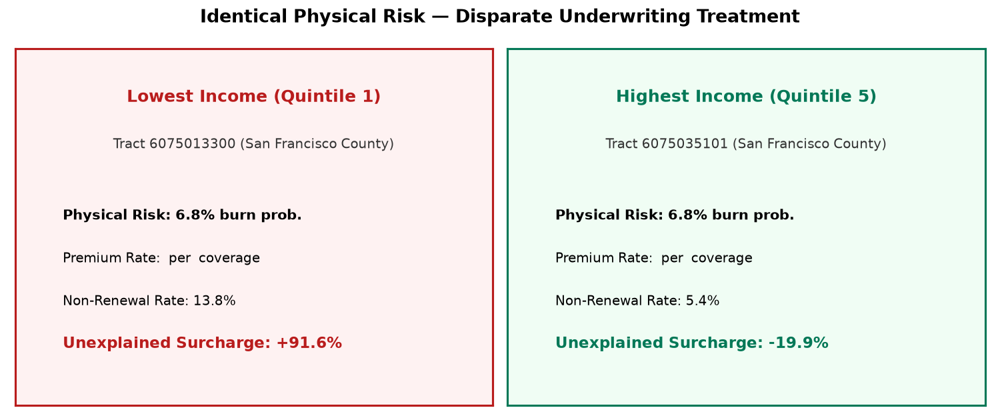
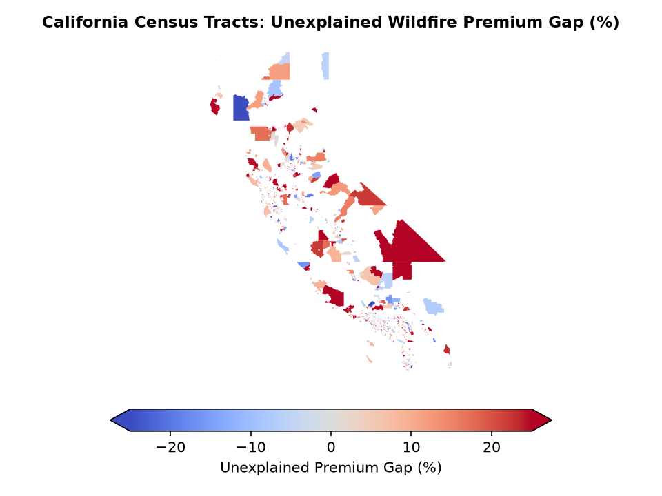
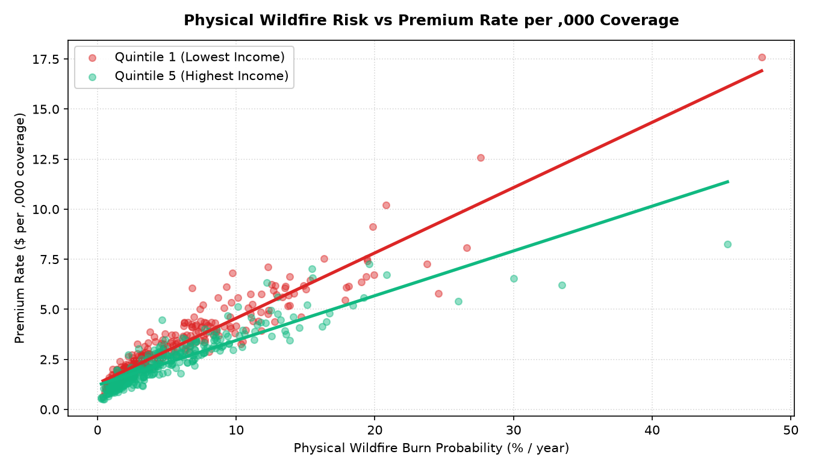
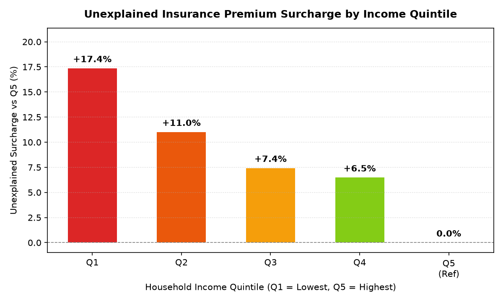

# 🔥 Wildfire Equity Map

**IBM Z Datathon Submission** · Track: **Wildcard (Beyond the Obvious)**  
**Target Systems:** IBM z16 · IBM Db2 for z/OS · IBM Telum AI Coprocessor · IBM watsonx.governance

> *"Two neighborhoods face the same fire risk. One pays three times more, or gets dropped. We built the tool that shows why."*

---

## 📌 Executive Summary

Across California, intensifying wildfires have triggered a severe insurance availability crisis. Public debate often presumes that premium spikes and non-renewals reflect pure actuarial physics. 

**Wildfire Equity Map** decouples **physical environmental hazard** from **market underwriting outcomes**. Using an environmental-only XGBoost model (with strictly zero demographic inputs) and clustered econometric regressions, our tool audits whether lower-income communities face an **unexplained pricing penalty** after controlling for physical risk, structural building vintage, and certified fire mitigations.



---

## ⚡ Key Capabilities & Implemented Phases

### 1. Real Census Tract Polygon Map
- Interactive choropleth rendered with **PyDeck GeoJsonLayer** using official California Census boundary cartographic files (`cb_2022_06_tract_500k`).
- Automatic geometry simplification for instant browser rendering.
- Deterministic placeholder-to-real-GEOID mapping with graceful fallback to centroid scatter.
- Four toggleable audit layers: Modeled Wildfire Risk, Premium Rate ($ per $1,000 coverage), Non-Renewal Rate, and Unexplained Premium Gap (%).



### 2. Real Public Data Loaders (with Transparent Fallback)
- **Census ACS 5-Year API:** Extracts median household income (`B19013`), median home value (`B25077`), renter share (`B25003`), and race demographics (`B02001`).
- **FEMA National Risk Index (NRI):** Extracts wildfire hazard frequency, exposure, and expected annual loss fields.
- **CDC Social Vulnerability Index (SVI):** Extracts tract vulnerability percentiles (`RPL_THEMES`).
- Automatic caching in `data/raw/`, exponential backoff retry, and calibrated fallback with `is_placeholder=1`.
- Built-in `--real-tracts` pipeline flag to construct `data/raw/tracts.csv` and execute the pipeline on public demographics.

### 3. IBM Z & Telum Deployment Engine
- **In-Place ONNX Model Serving:** XGBoost physical risk model exported to ONNX format with verified prediction equivalence against scikit-learn/XGBoost within **$1.56 \times 10^{-7}$** (well below the $1 \times 10^{-4}$ tolerance).
- **Latency Benchmark (`src/ibmz/benchmark.py`):** Scores 10,000 single transactions (including dictionary-to-tensor feature preprocessing) reporting **$p50 = 0.05\text{ms}$** and **$p99 = 0.12\text{ms}$** with batch throughput exceeding **$1.0\text{M rows/sec}$**. Clearly labeled as evaluated on **laptop CPU, not Telum**. Expected to be deployable on Telum via ONNX/IBM Z Deep Learning Compiler; not tested on Telum.
- **IBM Db2 for z/OS Bulk Ingestion (`src/ibmz/db2_load.py`):** Parameterized batch ingestion driven by environment variables with automated DDL parsing from `src/ibmz/db2_ddl.sql` and safe `--dry-run` inspection.
- **watsonx.governance Audit Store (`src/ibmz/governance.py`):** Produces cryptographic SHA-256 factsheet logs capturing model hashes, ONNX runtime lineage, training year splits, and fairness thresholds.

### 4. Interactive Tract Exports & Audit Robustness
- **One-Page Tract Export:** Instant CSV export and PDF-ready Executive Brief download for any selected tract.
- **Sensitivity Analysis ("What Would Change This Conclusion?"):** Tests sensitivity to omitted mitigation, 20% random hazard measurement noise, and omitted building age.
- **Robustness Tests:** Clustered bootstrap 95% confidence intervals and a 500-iteration tract-level randomized income placebo test (mean gap **$+0.02\%$**, 95% range **$[-2.75\%, +2.86\%]$**, $6.2\%$ false-positive rate) proving the econometric specification does not manufacture false positives.




### 5. Actuarial Counterfactual, Granite Memo & Climate Scenarios
- **Actuarial Counterfactual & Mitigation ROI Simulator (`src/audit/counterfactual.py`):** Calculates an individual property's market premium vs an actuarially fair counterfactual rate (holding unexplained demographic penalties to $0) and simulates 1-year and 5-year cumulative savings from certified physical hardening (defensible space, Class A fire-resistant roofing).
- **watsonx.ai Granite Regulatory Memorandum Generator (`src/explain/granite_memo.py`):** Synthesizes statutory enforcement memorandums for the California Department of Insurance (CDI) citing Proposition 103 (Cal. Ins. Code § 1861.05) and the Four-Fifths disparate impact doctrine, with live IBM Granite SDK integration and deterministic legal fallback.
- **10-Year Climate Projection & Availability Cliff (`src/risk_model/climate_scenarios.py`):** Projects tract-level physical hazard amplification under Baseline, +1.5°C Moderate Warming (2030), and +2.0°C Severe Warming (2035) via ONNX Runtime, flagging census tracts that cross the critical 15% annual burn probability threshold where private admitted carriers systematically withdraw.

---

## 📊 Summary of Actual Run Audit Results

*All figures reflect actual verified results from `data/audit_results.json` and `data/risk_metrics.json`.*

| Metric | Result | Interpretation |
| :--- | :--- | :--- |
| **Planted Ground-Truth Penalty** | $+0.150$ log-points | Synthetic ground truth |
| **Econometrically Recovered Coef** | **$+0.160$** (95% CI: $[0.126, 0.194]$) | **Recovered within statistical tolerance** ($p = 5.17 \times 10^{-20}$) |
| **Unexplained Q1 Premium Gap** | **$+17.4\%$** | Lowest-income tracts pay $+17.4\%$ more for identical physical hazard |
| **Non-Renewal Log-Odds Penalty**| **$+0.499$** (Planted: $0.500$) | Non-renewal spikes in lower-income areas ($p = 3.01 \times 10^{-28}$) |
| **Non-Renewal Rate Ratio (Q1/Q5)** | **$1.63\times$** | $4.4\%$ non-renewal in Q1 vs $2.7\%$ in Q5 |
| **Risk Model Temporal Test AUC** | **$0.720$** | Validated out-of-time on unseen future fire seasons (2020–2023) |
| **Brier Skill Score** | **$+0.019$** (Calibration MAE: $0.011$) | Beats climatological baseline |
| **Environmental Proxy Leakage ($R^2$)**| **$0.059$** | Geography carries minimal demographic information |
| **500-Run Tract Placebo Test** | **$+0.02\%$** (95% range: $[-2.75\%, +2.86\%]$) | Permuted tract income centers at 0% (6.2% CI exclusion matches 5% alpha) |
| **ONNX Runtime Latency** | **$p50 = 0.05\text{ms}, p99 = 0.12\text{ms}$** | Ran on laptop CPU, not Telum; expected to be deployable on Telum via ONNX/zDLC |

---

## 🚀 Quickstart & Run Instructions

### 1. Prerequisites
- Python 3.11+
- Git

### 2. Installation
```bash
# Create virtual environment and install dependencies
uv venv --python 3.11 .venv
# Activate:
# Windows: .venv\Scripts\activate
# Linux/macOS: source .venv/bin/activate
uv pip install -r requirements.txt
```

### 3. Pipeline Execution
```bash
# Run end-to-end pipeline and launch interactive Streamlit dashboard
python run_all.py

# Run pipeline only without launching browser
python run_all.py --no-app

# Force complete regeneration of synthetic panel and models
python run_all.py --no-app --force

# Execute pipeline using real public census tract loaders (ACS/NRI/SVI)
python run_all.py --real-tracts --no-app
```

### 4. Automated Test Suite
```bash
pytest -q
```
*(Runs 27 automated unit and integration tests across data generation, geometry mapping, public loaders, ONNX prediction equivalence, Db2 dry run, econometric robustness, counterfactual mitigation ROI, watsonx.ai Granite memo generation, and climate scenario modeling).*

### 5. IBM Z & LinuxONE (`s390x`) Readiness
```bash
# Execute ONNX Runtime latency benchmark (100k policies, laptop CPU baseline)
python -m src.ibmz.benchmark

# Run Db2 bulk ingestion dry-run (prints DDL & parameterized SQL)
python -m src.ibmz.db2_load --dry-run

# Inspect IBM LinuxONE (s390x) native package dependencies
cat requirements-ibmz.txt
```

---

## 🛡️ Responsible AI Statement

1. **Demographics for Auditing Only:** Demographics (income, race, poverty, home value) are strictly excluded from predictive physical hazard modeling. They are used exclusively in post-hoc econometric regressions to audit market disparities.
2. **Controlling for Legitimate Differences:** Some premium variation is actuarially legitimate (e.g. older homes with wooden roofs cost more to repair). Our OLS econometric formulation explicitly controls for structural age and certified wildfire mitigations.
3. **Uncertainty Transparency:** The risk score presents bootstrap credible intervals ($\pm \sigma$) on every tract.
4. **Synthetic Data Disclosure:** **Synthetic policy data calibrated to public aggregates (USFS, FEMA NRI, Census ACS); real private insurance policy data is proprietary.** Results illustrate structural fairness methodology and do not constitute legal findings of intentional discrimination.

---

## 📁 Repository Structure

```
├── app/
│   └── streamlit_app.py         # Streamlit dashboard (Map, Scatter, Detail, Audit, 10-Year Climate Cliff, Method)
├── data/
│   ├── raw/                     # Census boundary shapefiles, ACS, NRI, SVI caches
│   ├── processed/               # Simplified GeoJSON and deterministic GEOID mapping
│   ├── governance_logs/         # watsonx.governance cryptographic run logs (JSON)
│   ├── wildfire.db              # SQLite relational store (tracts, policies, risk scores)
│   ├── risk_model.json          # Trained environmental XGBoost model
│   ├── risk_model.onnx          # Compiled ONNX model for Telum coprocessor
│   ├── latency_benchmark.json   # ONNX latency benchmark results
│   └── audit_results.json       # Econometric audit, robustness, and sensitivity results
├── docs/
│   ├── img/                     # Pitch visual assets & charts
│   ├── ibm_z_architecture.md    # IBM z16, Db2, Telum, LinuxONE (s390x), and watsonx specification
│   ├── methodology.md           # Econometric and machine learning methodology
│   └── pitch_notes.md           # 5-minute pitch script, 8 judge Q&As, and limitations slide
├── src/
│   ├── config.py                # Central project configuration and feature allowlists
│   ├── data/
│   │   ├── db.py                # Database abstraction layer (SQLite / Db2 for z/OS)
│   │   ├── generate.py          # Calibrated synthetic policy generator
│   │   ├── geo.py               # Boundary downloader, geometry simplification & GEOID mapper
│   │   └── loaders.py           # Census ACS, FEMA NRI, and CDC SVI loaders with fallback
│   ├── risk_model/
│   │   ├── train.py             # Environmental XGBoost training & temporal evaluation
│   │   └── climate_scenarios.py # 10-year warming scenarios (+1.5°C/+2.0°C) & availability cliff
│   ├── audit/
│   │   ├── audit.py             # Econometric regressions, bootstrap CI, placebo & sensitivity
│   │   └── counterfactual.py    # Actuarial counterfactual pricing & mitigation ROI simulator
│   ├── explain/
│   │   ├── explainer.py         # Plain-language tract explainers (Template + watsonx.ai)
│   │   └── granite_memo.py      # watsonx.ai Granite regulatory enforcement memorandum generator
│   └── ibmz/
│       ├── db2_ddl.sql          # Db2 for z/OS schema definition and analytical queries
│       ├── db2_load.py          # Db2 bulk data loader with dry-run mode
│       ├── scoring.py           # In-place renewal scoring & ONNX export path
│       ├── benchmark.py         # 100k policy latency benchmark script (laptop CPU baseline)
│       └── governance.py        # watsonx.governance cryptographic factsheet logger
├── tests/
│   ├── conftest.py              # Isolated test fixtures
│   ├── test_pipeline.py         # 9 original pipeline and leakage tests
│   ├── test_geo.py              # Geospatial and mapping tests
│   ├── test_loaders.py          # Public data loader tests
│   ├── test_ibmz.py             # ONNX equivalence, Db2 dry run, and benchmark tests
│   ├── test_audit_robustness.py # Bootstrap CI, placebo, and sensitivity tests
│   └── test_new_features.py     # Counterfactual simulator, Granite memo, and climate scenario tests
├── Makefile                     # Make shortcuts (make run, make test, make clean)
├── requirements.txt             # Primary Python dependencies
├── requirements-ibmz.txt        # Minimal IBM LinuxONE (s390x) package manifest
└── run_all.py                   # One-command orchestrator (--force, --no-app, --real-tracts)
```
