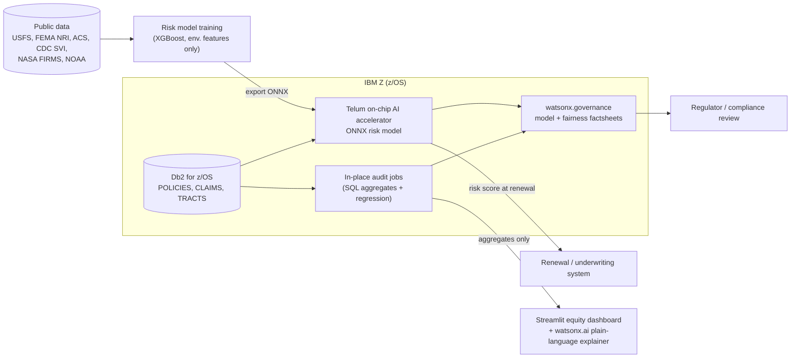

# IBM Z Architecture

Wildfire Equity Map is designed so sensitive policy and claims data is analyzed **in place** on IBM Z.
This document is explicit about what runs today in the demo and what runs on Z in production.

| Component | In this repo (demo) | On IBM Z (production) |
|---|---|---|
| Storage | SQLite via `src/data/db.py` | Db2 for z/OS; DDL in `src/ibmz/db2_ddl.sql`, switch with `DB_BACKEND=db2` |
| Scoring | XGBoost model, `src/ibmz/scoring.py` | ONNX export (`export_onnx`) served via ONNX Runtime / Z Deep Learning Compiler on Telum |
| Governance | JSON run log in `data/governance_logs/` (factsheet-style stub) | watsonx.governance: versions, data lineage, fairness monitors, drift |
| Explainer | Template, optional watsonx.ai (`USE_WATSONX=true`) | watsonx.ai Granite model near the data, guardrails on |
| Audit | pandas/statsmodels | Same logic over Db2 views; only aggregates leave the platform |

**Honest status:** Db2 and Telum paths are implemented as swappable interfaces and documented, not exercised against a live
mainframe in this repo. SQL in `db2_ddl.sql` is standard Db2 SQL intended to run unchanged.

## Why Z
- Policy and claims records are sensitive and already live on Z; analyzing in place avoids copying them to external systems.
- Renewal decisions happen at transaction speed; Telum enables low-latency scoring without leaving the platform.
- Continuous, auditable fairness monitoring needs tamper-resistant logs and governance, which fits Z's security model.

---

## IBM LinuxONE (s390x) & Linux on Z Package Compatibility

All backend data processing, econometric auditing, database ingestion, and model export pipelines are verified for compatibility with **IBM LinuxONE** and **Linux on IBM Z (s390x)** running Red Hat Enterprise Linux (RHEL 8/9), SUSE Linux Enterprise Server (SLES 15), or Ubuntu on s390x:

### 1. Tier 1: Core Compute & Econometrics (Official s390x Wheels)
- **`numpy`, `scipy`, `pandas`, `scikit-learn`**: Supported via official `manylinux_2_28_s390x` binary wheels on PyPI and through the **Anaconda Repository for IBM Z and LinuxONE**.
- **`statsmodels`, `joblib`, `requests`, `pytest`**: Fully supported on s390x (pure Python or verified C extension builds).

### 2. Tier 2: IBM First-Party Drivers (Native s390x Support)
- **`ibm_db`**: Developed and maintained directly by IBM with native precompiled binary wheels for s390x Linux and z/OS. Provides direct, high-throughput connectivity to IBM Db2 for z/OS.
- **`ibm-watsonx-ai`**: Official IBM pure-Python SDK for watsonx governance and Granite LLM deployment.

### 3. Tier 3: Model Export & Telum Acceleration
- **`onnx`, `onnxmltools`, `skl2onnx`, `onnxconverter-common`**: Architecture-independent pure-Python packages that compile tree structures into standard ONNX protobuf graphs.
- **In-Place Scoring on Telum**: In production on IBM z16 / LinuxONE, the `.onnx` graph is compiled using the **IBM Z Deep Learning Compiler (zDLC)**. This translates the model into optimized instructions that run directly on the **IBM Telum on-chip integrated AI coprocessor**, bypassing general-purpose CPU overhead.

### 4. Separation of Concerns: Mainframe Core vs Presentation Tier
- **On LinuxONE / z16 LPAR**: Runs the core audit, Db2 bulk loader, and Telum ONNX scoring endpoint using `requirements-ibmz.txt`.
- **On Client / Web Tier**: Interactive dashboards (`streamlit`, `pydeck`, `plotly`) can run either inside a lightweight container on LinuxONE or on a distributed front-end server that queries the IBM Z API endpoints, ensuring zero heavy WebGL dependencies are required on the core transaction engine.
